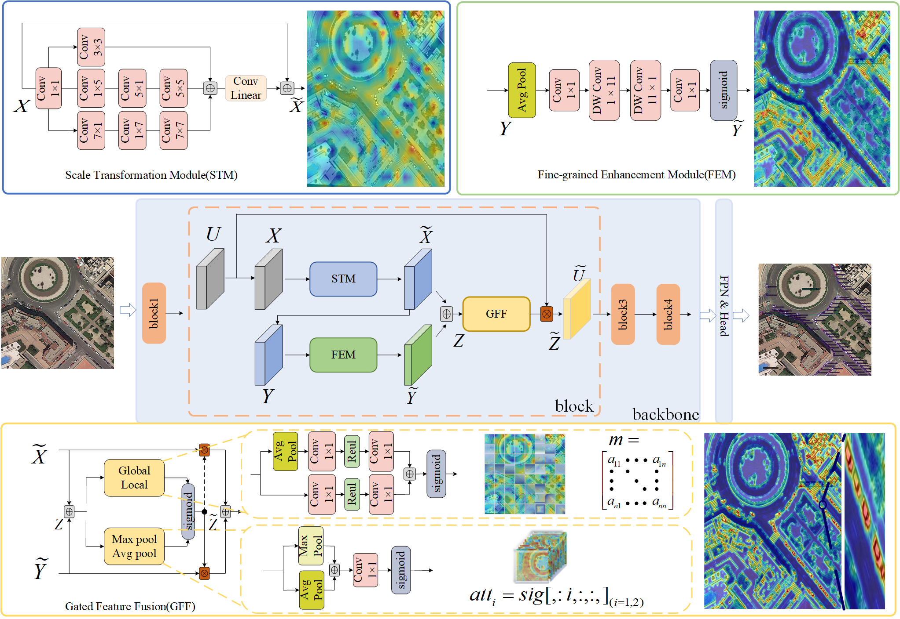

# MSTENet: Multi-kernel Scale Transformation Enhancement Network with Gated Feature Fusion for Remote Sensing Object Detection 


## Overview

MSTENet is designed to address scale variations and complex backgrounds in remote sensing object detection. It combines a **Scale Transformation Module (STM)** for multi-scale receptive field modeling, a **Fine-grained Enhancement Module (FEM)** for preserving target details, and a **Gated Feature Fusion (GFF)** module for adaptive feature integration. The enhanced features are processed by an FPN and an oriented detection head to produce precise detection results.

<p align="center">
  
</p>


## Results and Models

### Pre-trained Backbones

The MSTENet backbones are pre-trained on ImageNet for 300 epochs.

- **MSTENet-T**: 
- **MSTENet-S**: [Download](https://github.com/zga1999/MSTENet/releases/download/Weights_Logs/dota_MSTENet-S_fpn_oriented_1x.pth)

### DOTA-v1.0(split_ms_dota)
| Model     | mAP   | Angle | Lr schd | Batch Size | Configs | Download |
|---        |---    |---    |---      |---         |---      |-     |
| MSTENet-T | 81.59 | le90  | 1x      | 1×8        | [config](https://github.com/zga1999/MSTENet/blob/main/projects/mstenet/dota_mstenet-t_fpn_oriented_1x.py) |   |
| MSTENet-S | 82.72 | le90  | 1x      | 2×8        | [config](https://github.com/zga1999/MSTENet/blob/main/projects/mstenet/dota_mstenet-s_fpn_oriented_1x.py) | [model](https://github.com/zga1999/MSTENet/releases/download/Weights_Logs/dota_MSTENet-S_fpn_oriented_1x.pth) \| [log](https://github.com/zga1999/MSTENet/releases/download/Weights_Logs/dota_MSTENet-S_20260222_233323.log)   |


### DIOR
| Model     | mAP   | Angle | Lr schd | Batch Size | Configs | Download |
|---        |---    |---    |---      |---         |---      |---   |
| MSTENet-S | 68.84 | le90  | 1x      | 2×8        | [config](https://github.com/zga1999/MSTENet/blob/main/projects/mstenet/dior_mstenet-s_fpn_oriented_1x.py) | |


### HRSC2016
| Model    | mAP(07) | mAP(12) | Angle | Lr schd | Batch Size | Configs | Download |
|---       |---      |---      |---    |---      |---         |---      |---   |
| MSTENet-S| 90.67   | 98.52   | le90  | 1x      | 2×8        | [config](https://github.com/zga1999/MSTENet/blob/main/projects/mstenet/hrsc2016_mstenet-s_fpn_oriented_1x.py) |  | 


## Installation

MSTENet is implemented based on [MMRotate 1.x](https://mmrotate.readthedocs.io/en/1.x/), [PyTorch](https://pytorch.org/), [MMCV](https://github.com/open-mmlab/mmcv), [MMDetection](https://github.com/open-mmlab/mmdetection), and [MMEngine](https://github.com/open-mmlab/mmengine). The following steps provide instructions for setting up the environment.

```bash
conda create -n mmrotate1x python=3.10 -y
conda activate mmrotate1x

pip install torch==2.1.2 torchvision==0.16.2 --index-url https://download.pytorch.org/whl/cu121

pip install -U openmim
mim install "mmengine==0.10.7"
mim install "mmcv==2.1.0"
mim install "mmdet==3.3.0"

pip install numpy==1.26.4 timm==1.0.28

git clone https://github.com/zga1999/MSTENet.git
cd MSTENet
pip install -v -e .
```

To verify the installation, run:

```bash
python -c "import torch, mmcv, mmdet, mmengine, mmrotate; print(torch.__version__, mmcv.__version__, mmdet.__version__, mmengine.__version__, mmrotate.__version__)"
```

**Note:** MSTENet requires MMRotate 1.x and is not compatible with the MMRotate 0.x installation procedure. The commands above target a CUDA 12.1 environment.


## Citation


```bibtex

```
